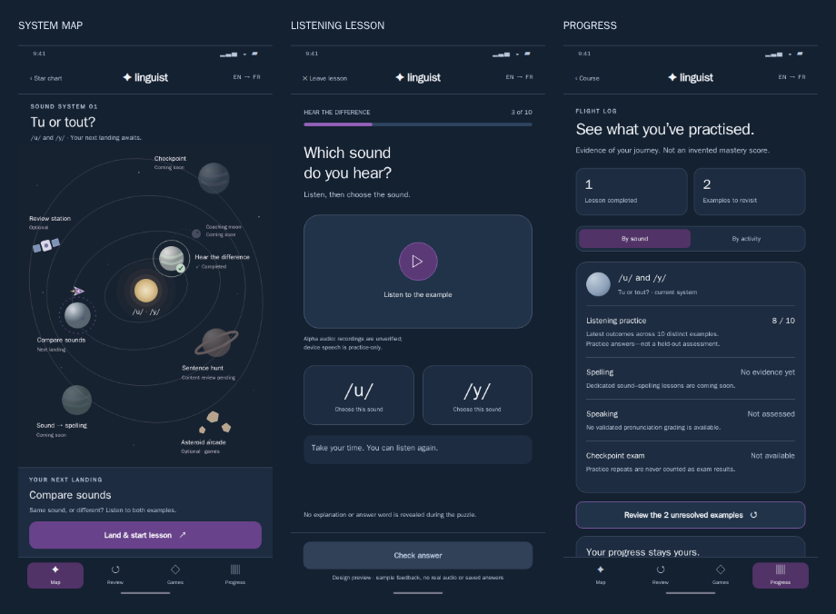

# Map-first space course design

**Status:** written design approved by the user on 2026-10-23 and merged through
[PR #101](https://github.com/klottick/phoneme-app/pull/101). Approval permits
implementation planning, not product-code execution or release. The separate
[implementation plan](../plans/2026-10-23-map-first-space-implementation.md)
awaits its own approval.

**Baseline:** published `origin/main`,
`b2789cbf356de2144bef82e54f45662fa4fecf80`, fetched on 2026-10-23.

## 1. Purpose and priority

Make the lesson journey visible early. A learner should arrive at a recognizable
space-exploration map, understand their current sound focus, and reach the next
real activity without interpreting a collection of development-feature cards.
The map must also show where the course is going without pretending unfinished
lessons are playable.

This moves a scoped **FR-11-A map-first delivery**, including the necessary
Home/router/theme portion of FR-18, ahead of spelling, assessments, and the rest
of the course backlog. It does not declare the full FR-11 or FR-18 complete.
See the [broader backlog](../plans/2026-10-10-french-learning-path-tickets.md).

### Agreed visual direction

- Phone-first solar-system view, not a winding path through lesson buttons.
- A ship slowly orbits the learner's current destination.
- Individually authored routes; orbital distance does not establish lesson order.
- Faded inaccessible bodies remain inspectable and explain their availability.
- Slight background activity, with motion reduction and pause controls.
- Midnight blue throughout the course's dark appearance, with deeper purple
  actions, selected states, and ship accents. No purple background wash.
- Atmospheric navigation; quieter, focused exercise screens.

The following are durable captures of the selected preview, not live app screens:

[Full-size phone map](assets/2026-10-23-space-course/approved-map.png).
All displayed progress, answers, and unlocks in these images are illustrative.
Sections 3–6, not the sample image, determine actual first-delivery behavior.

## 2. What the map entities mean

| Entity | Meaning | Constraints |
| --- | --- | --- |
| Star chart | The English → French course and its sound systems | Shows available and planned systems without claiming a complete French curriculum. |
| Solar system | A related sound family, contrast, or focused production difficulty | “Tu or tout?” focuses on `/u/`–`/y/`; French R can be a single-focus system. Not every system must have a pair. |
| Star | The system's central identity | Decorative/contextual; not a score or a learning task. |
| Planet | A finite lesson or checkpoint with its own objective | Never one planet per phoneme merely because the sound exists in the word catalogue. |
| Moon | Optional planet-related practice or articulation coaching | No mandatory moon completion before a required lesson. |
| Station | Review or clearly labeled cross-system practice | Uses actual saved mistakes or the existing activity; does not manufacture a new lesson. |
| Asteroid field | Optional arcade detour | Existing game mechanics, checkpoints, timers, and evidence rules remain unchanged. |
| Ship | Learner location and continuation cue | No fuel, lives, currency, inventory, movement-based credit, or score. |

Systems have stable presentation identities and explicit mappings to real
activities. Existing course, lesson, section, item, audio, owner, and database
identities do not change. The same sound appearing in several systems must not
create independent or invented mastery scores.

## 3. First-delivery scope

### Included

1. An orbital course Home, an explicit star-chart view, an inspectable destination
   panel, and reachable Map / Review / Games / Progress navigation.
2. One live `/u/`–`/y/` system using the existing discovery lesson, plus honestly
   labeled future destinations and optional practice links.
3. Existing mixed comparison, sentence-section availability, games, review,
   progress, settings, and legacy-practice access preserved.
4. Approved color tokens on the new shell and the existing supported course
   surfaces in dark appearance, without rewriting their exercise/session logic.
5. Slow ship orbit and restrained decorative activity, reduced-motion behavior,
   keyboard/semantic access, and a non-spatial destination list.

### Not included

- New lesson content, splitting the existing comparison catalogue, new spelling
  puzzles, a new coaching library, assessments, or pronunciation grading.
- Unlocking pending word/sentence recordings or changing their audio policies.
- New storage schemas, migrations, a second progress store, cloud download/merge,
  recordings uploads, or revised completion thresholds.
- A global legacy-screen redesign, new typography dependency, purchased artwork,
  additional games, gameplay reskins, or a solar-system physics simulation.
- Pixel-for-pixel conversion of every preview screen in the first map delivery.
  Its broader screen layouts are a starting direction for later scoped work.

### Actual content mapping, not the mockup's fictional course

The initial system has presentation ID `en-fr-u-y-system`. Its discovery planet
maps to `lesson:en-fr-u-y` and the existing `/course-lesson/en-fr-u-y` route.

| Destination | First-delivery behavior |
| --- | --- |
| Hear the difference | Live discovery planet. Use its real saved session and current-revision `discoveryThreshold` completion. Preserve the existing alpha-audio disclosure. |
| Compare `/u/` and `/y/` | Planned system-specific lesson; “Coming soon.” Do not pretend that a dedicated comparison section has been authored. |
| Find sounds in context | Planned system-specific lesson. The existing mixed sentence-hunt group is not silently remapped into this planet. |
| Sound → spelling | Planned lesson; “Coming soon.” Existing game hints are not a substitute. |
| Checkpoint | Planned assessment; “Coming soon,” not an unassessed zero score. |
| Coaching moon | Planned optional destination; do not claim brief legacy tips fulfill the reviewed coaching feature. |
| Review station | Existing `/course-review`, with real item-linked review behavior. |
| Mixed comparison practice | Optional cross-system station linking `/course-comparison/en-fr-phoneme-comparison`; explicitly mixed-sound alpha practice, separate evidence/completion. |
| Sentence practice | Inspectable optional destination to `/course-sentence-hunt`; retain its real qualification checks and unavailable sections. |
| Asteroid arcade | Existing `/arcade` lobby, preserving both games and their routes. |

The existing comparison activity includes vowels and consonants beyond `/u/` and
`/y/`; see `frontend/lib/src/core/course/french_comparison_content.dart`. Neither
its completion nor its attempt totals advance the dedicated discovery planet.
The sentence package similarly has vowel, consonant, and mixed sections, not a
qualified `/u/`–`/y/` lesson. Its pending review is not solved by navigation.

The star chart shows the live system and planned Nasal vowels / French R systems.
These planned systems explain their future focus but have no new launch action.
Existing nasal/R/vowel/mixed legacy lessons remain reachable under an explicit
Legacy practice entry, with their original routes and historical counts. A
planned redesigned system does not remove existing legacy practice.

## 4. Authored routes, access, and honest state

Model three separate dimensions, rather than one “locked” boolean:

1. **Readiness:** usable alpha practice, planned, qualification-blocked, or
   unavailable because content/state could not be checked.
2. **Progress:** not started, resumable, or durably completed under the activity's
   existing policy. Unknown data is not “not started.”
3. **Recommendation:** a suggested next destination, not permission to enter it.

An authored prerequisite graph is independent of orbital position and semantic
reading order. Required content cannot depend on optional detours. Unknown IDs,
cycles, missing required links, and misleading activity mappings fail validation
for the affected system rather than opening arbitrary routes.

**First-delivery policy:** do not introduce new progression locks on existing
live activities. The preview's “finish identification before comparison” state
was illustrative, not an approved new restriction. Readiness gates still apply.
Future lesson authoring may establish real prerequisites in a separately reviewed
content/route change; this map architecture must support them without inventing
them now. A drawn lock is never a substitute for route enforcement.

Availability dominates any completion or recommended marker. A qualification-
blocked body cannot become playable by finishing another lesson. Planned bodies
say “Coming soon”; qualification-blocked bodies explain the review requirement;
loading/error states offer retry. Use fading plus text, icon, and accessible
state—not color/opacity alone.

A tap selects a body and updates the destination panel. It does not navigate,
initialize audio, move the ship, write progress, or alter completion. The panel's
explicit action opens a validated existing destination only when appropriate.
Previously completed lessons remain revisit-able with existing review semantics.

## 5. Current destination and saved progress

The map is a read-only projection over the current owner/course repositories.
Reuse `CourseCompletionSummary`, the comparison summary, sentence qualification
and progress projections, and existing providers. Do not infer completions from
attempt totals or from the position of a ship.

For the initial system, the ship's continuation anchor is the discovery planet:

- A valid saved discovery session offers Continue and preserves its exact phase.
- With no saved session/completion, offer Start the discovery lesson.
- After a committed current-revision discovery completion, offer Review
  discovery. If all available system-specific lessons are complete, say so;
  do not move the ship to an unfinished comparison, spelling, or exam planet.
- Historical one-pass completion does not become discovery-threshold completion.
- Cross-system practice and arcade completion do not change this anchor.

Generalized recommendation is authored per system: first honor an existing
resumable supported main activity, otherwise choose the first eligible incomplete
main destination in an explicit authored recommendation order. If none exists,
show an all-currently-available-lessons-complete state. The first system has only
one live main lesson; it must not imply a larger delivered course.
If several main activities are resumable, use that same authored order as the
tie-breaker; do not invent recency from missing timestamps.

Only acknowledged durable completion updates map markers. Finish/save failure
leaves the map unchanged and retains the existing retry flow. Do not create a
map-specific “last completed” record. Counts distinguish available lessons,
planned lessons, historical completions, practice answers, and assessment; never
show a fabricated course/mastery percentage.

Provider loading, explicit refresh, errors, corruption, and guest/A/B changes
must not retain another owner's ship, counts, due mistakes, or selected feedback.
Render neutral unknown progress while relevant data loads. Preserve existing
recovery controls and raw-data preservation. A failing comparison family must
not suppress valid discovery data; failing course state must not be replaced
with an empty guest profile. Selection/animation state is ephemeral, never a new
learning namespace. This slice adds no new persisted navigation preference.

## 6. Navigation and architecture boundaries

### Entry and compatibility

- Keep `/home` as the course entry after onboarding; it shows the initial system
  map rather than the current development-card collection.
- Add `/course-chart` for the course-level star chart and
  `/course-system/:systemId` for explicit system links. The initial valid ID is
  `en-fr-u-y-system`. Unknown/planned system links show a safe explanation and a
  reachable return action, not fallback content or a fabricated empty system.
- Map navigation returns to `/home`; Review, Games, and Progress retain
  `/course-review`, `/arcade`, and `/course-progress` respectively.
- Star chart and supported root destinations may share a presentation shell;
  active lessons and game boards do not gain extra bottom tabs or nested timers.
- Preserve existing direct lesson, comparison, targeted-review, sentence, game,
  settings, and legacy-tool routes, including validated query parameters.
- Returning from a lesson selects the same system and projects fresh committed
  state. Back/Finish must retain the existing one-exit and checkpoint behavior;
  repeated tab activation cannot restart an activity or accumulate duplicate
  root screens.

### Responsibilities

| Boundary | Responsibility | Must not own |
| --- | --- | --- |
| Authored map catalogue | System/body IDs, labels, orbital layout, recommendation order, optional roles, explicit activity/destination bindings | Learner state, audio, grading, copied answer keys |
| Map-state projection | Combine relevant committed summaries and readiness into detached body/continuation state | Writes, retries, schema changes, per-frame provider queries |
| Map/star-chart renderer | Static body geometry, hit targets, selected-body panel, linear destination list | Progress decisions, arbitrary string-built routes |
| Navigation adapter/shell | Map typed destinations onto validated routes and preserve entry/back behavior | New lesson sessions or gameplay logic |
| Space appearance | Shared semantic color roles and component styling | A second theme preference store or broad legacy refactor |
| Decorative motion layer | Ship orbit, stars/comet, pause and visibility behavior | Completion, scheduling, audio, random lesson order |

The new presentation catalogue is an adapter, not a rewrite of FR-01's
`CourseCurriculum` or its frozen IDs. Its validation checks mapped activity
identity and instructional coverage. Do not treat the course-wide planned graph
as proof that every system has the same sequence. Exact module/API signatures
and worker ownership belong in the later implementation plan.

Existing integration owners include `features/home/home_screen.dart`,
`routing/app_router.dart`, `core/theme/app_theme.dart`, and the course summary/
provider modules. Keep map metadata and projection pure where possible; keep the
renderer and lifecycle animation separate. Do not add dependencies merely to
draw the system; use authored primitive/vector illustration without new rights
or remote-image requirements.

## 7. Phone layout, accessibility, and motion

Use 390×844 as the primary reference and verify 360×640 plus large text. Preserve
the orbital feel on phones without shrinking text to the prototype's decorative
SVG label sizes. Use normal readable UI text for essential labels and at least
48×48 logical-pixel interactive targets. Adapt placement, pan/scroll, or use the
linear destination list when the spatial layout cannot fit; never clip actions,
force landscape, or rely on pinch zoom.

The selected-destination panel and root navigation stay reachable within safe
areas. Long names and large text may make the panel scrollable/expandable rather
than hide its action. The map must provide a keyboard/screen-reader order based
on authored learning order and optional groups, independent of planet positions.
Every destination communicates its title, role, availability, progress, selection,
and action. Inspection and launch are distinct controls.

One ship lap takes approximately **34 seconds**. It orbits the current activity's
body, not whichever body was last inspected. Inspection does not travel; actual
destination changes or newly committed progression may change its anchor.
Provide an equivalent stationary location indicator for assistive technology.

Stars have slow, low-amplitude variation; an occasional comet is decorative.
No flashing, automatic audio, constantly orbiting lesson planets, or particle-
heavy effects. Positions are stable, not randomized by rebuild. Isolate animation
repaints from learning providers and stop decorative tickers when the map is
covered, hidden, paused, or disposed. Opening a lesson leaves no active map
animation behind it.

Honor the device/platform reduced-motion signal and an explicit map pause
control. Reduced motion takes precedence; a paused/reduced map stays fully
usable. The pause control has a named state and remains keyboard reachable.
This delivery need not persist a new motion setting across app restarts.

## 8. Theme and screen presentation

| Semantic role | Selected value |
| --- | --- |
| Space canvas | `#172231` |
| Main background / navigation | `#142131` |
| Panels / cards | `#1D2C40` |
| Raised surfaces | `#213349` |
| Borders | `#3C4C62` |
| Primary action | `#68428A`, light label |
| Selected surface | `#513367`, light icon/label |
| Ship hull | `#70438F`, pale outline/window for visibility |
| Current ring / stronger accent | `#9461BA` |
| Primary text | `#F3F5F9` |
| Secondary text | `#B9C8DB` |

Purple marks identity, selection, and action—not correctness or availability.
Success/error states remain semantic and include text/icons. Retain natural
planet colors and warm starlight. No global purple haze or broad gradient wash.

**Theme-policy proposal for review:** preserve the existing Light/Dark/System
preference and `theme_mode` storage. Apply the selected palette to the supported
course's dark appearance, without silently forcing a user's saved light setting
or re-theming all legacy tools. The space artwork stays midnight blue in either
appearance; light-mode controls retain existing readable light styling. The
approved mockups specify the dark appearance, not a newly designed light theme.
Changing the default theme or making the whole course dark regardless of the
setting is a separate decision, not assumed here.

Within that policy, the palette spans Home/star chart/map, discovery/comparison
lesson and debrief surfaces, review/progress, and the arcade lobby. First delivery
may restyle containers and shared controls on these existing surfaces but must
not replace their controllers, correctness/help timing, existing labels, or
recovery actions. Preserve game-board tiles and mechanics; do not blindly apply
purple to answer groups, matching hints, or scoring feedback.
Keep the course appearance scoped to these destinations; changing shared
`DesignColors` must not accidentally recolor every legacy tool or erase the
existing theme-setting behavior. Do not bundle cleanup of the duplicate legacy
theme-service definitions with this feature.

The preview's focused lesson, section-end explanation, targeted review, two-game
lobby, and honest progress breakdown guide later layout refinement. Do not add
mockup-only tabs, a universal mastery percentage, simulated playback, or fake
answer state to production in order to match an image.

## 9. Preservation and verification requirements

| Area | Acceptance required before implementation delivery |
| --- | --- |
| Visible journey | A new guest reaches the live system map after onboarding, sees the discovery focus and future destinations, and can launch the real pilot. Star chart is reachable. |
| Actual mapping | Comparison remains labeled mixed alpha practice; no relabeling, filtering, or transferred completion. Sentence qualification still blocks unavailable sections. |
| Readiness | Planned, qualification-blocked, and data-unavailable states are distinguishable. Inspection cannot unlock/launch them; unknown IDs and invalid mappings fail safely. |
| Existing access | Every current supported/legacy destination remains reachable. No newly imposed prerequisite lock on existing live activities; existing validated direct links keep their behavior. |
| Durable progress | Real resume/first-pass/debrief/review phases, saved threshold, historical completion distinction, held/failed Finish, exact retry, and acknowledged publication remain intact. |
| Owner isolation | Guest→A→B→A, loading/refresh, failed load, and late callbacks cannot leak markers, counts, or selected learner state. Unavailable state is never a fresh empty profile. |
| Motion | Stable geometry, slow local orbit, inspection without travel, stationary reduced-motion equivalent, pause, and no background/covered-route ticker or audio startup. |
| Phone/accessibility | 390×844, 360×640, 2×/3× text, 48px hit targets, keyboard inspection/launch, semantic state, reachable actions, and usable non-spatial list. No horizontal page overflow. |
| Appearance | Approved blue/purple roles on supported dark course surfaces; Light/Dark/System preference preserved. Check actual text, active/disabled/focus/selection, and non-text contrast—not just swatches. |
| Existing games/audio | Existing one-minute timer, game exits, checkpoint persistence, review evidence, cancellation, replay/hearing gates, and alpha-audio disclosure unchanged. |
| Scope | No assets qualify by being displayed on a map; no schema migration, recording upload, grading, backend extension, source cleanup, or unrelated release gate closure. |

Use test-first regressions for new behavior and preservation fixtures for the
existing routes/session/store contracts. Relevant existing suites include
`home_navigation_test.dart`, `course_flow_test.dart`,
`discovery_entry_flow_test.dart`, `comparison_entry_flow_test.dart`,
`sentence_hunt_entry_flow_test.dart`, course progress/resume, and game/audio
lifecycle tests. The implementation plan must name new catalogue/projection,
rendering, semantics, motion, and theme tests and exact executable commands.

At product delivery, independently run applicable focused tests, the ordinary
Flutter regression gate, analysis, and a JavaScript web build. Respect the
already approved pre-alpha deferral of expensive storage/platform stress work;
record exclusions rather than claiming full qualification. Perform a bounded
browser flow at the final integrated build. Do not relabel fake audio, screenshot
geometry, successful build, absent CI, or synthetic semantics tests as qualified
French, real device playback, assistive-technology, or release acceptance.

Prototype checks already observed: seven screen views at 390×844, retained
`#172231` canvas, and core color ratios of 7.68:1 for white button text, 8.31:1 for
secondary text on panels, and 3.57:1 for the current ring on space. These are
prototype observations, not app regression or full accessibility evidence.

## 10. Delivery and next approval gate

This document and its visual references are documentation only. The current
demo and all existing user progress remain unchanged.

After written-spec approval, write a separate, small-PR implementation plan for
the map-first delivery. Include the presentation catalogue/projection, responsive
shell/map, appearance integration, and final route/preservation verification;
do not fold unfinished course-content work into it. Use current published
`origin/main` in isolated scoped branches, the standing sequential implementer
workflow, independent code review, controller verification, and reviewed GitHub
PR integration. No direct `main` push, unreviewed merge, or automatic deletion
of older worktrees, Sound Match work, user files, or evidence.

**Decisions this written review makes explicit:** keep the first delivery ahead
of unfinished curriculum; retain existing live access rather than copy mockup
locks; expose the existing comparison as cross-system practice; and preserve
the saved theme-mode preference. Approval of this document permits implementation
planning, not product-code execution. The later plan needs its own approval.
