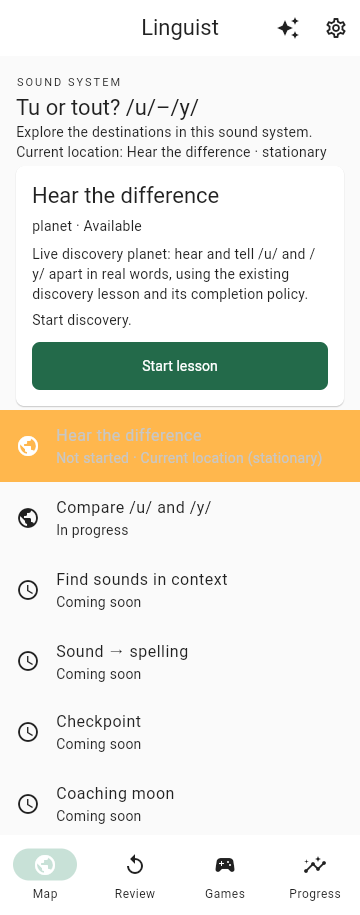
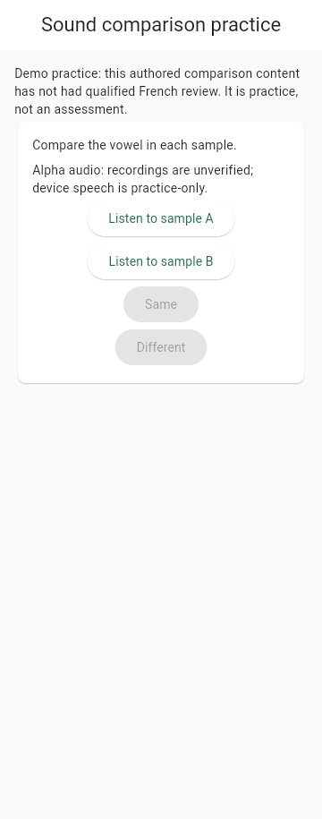

# Dedicated /u/–/y/ comparison demo: delivery and acceptance status

**Outcome:** The scoped, best-effort dedicated /u/–/y/ comparison practice
destination is delivered and published. Its code was reviewed and merged through
PRs #112–116, then the JavaScript demo built from that published code was updated
and verified locally and at the hosted URL. This is a dedicated comparison demo,
not a whole mini-course, full FR-11/FR-18 delivery, qualified lesson, assessment,
or mastery claim. The approved scope and remaining gates are defined by the
[design](../specs/2026-10-23-uy-demo-comparison-design.md) and
[implementation plan](../plans/2026-10-23-uy-demo-comparison-implementation.md).

The activity contains the ten authored pairs `uy-demo-pair-01` through
`uy-demo-pair-10`, each targeting ordinal 1: five Same and five Different. All
are pending practice content using the existing alpha-practice recordings; the
saved checkpoint, answers, summary, and completion belong to this activity. The
recommended main path is discovery followed by the dedicated comparison. The
optional mixed comparison remains separate, and discovery and comparison
progress are independent. Context, spelling, and checkpoint destinations
remain planned.

## Approval and publication record

Design and implementation-plan approval were separate decisions from code
delivery. The design was approved and published as PR #110; the plan was
separately approved and published as PR #111. Those approvals authorized only
this scoped best-effort practice delivery, not product work beyond it or closure
of linguistic, rights, playback, assessment, privacy, accessibility, or release
gates.

| Scope | PR | Reviewed head | Merge commit |
| --- | --- | --- | --- |
| Approved design | [#110](https://github.com/klottick/phoneme-app/pull/110) | `e7474fc1a16567c2e865dda96336420937fc9156` | `4739110598d9c3986808f9060f29874fcf8a5a02` |
| Approved implementation plan | [#111](https://github.com/klottick/phoneme-app/pull/111) | `fa943a4c4ba3fb21babe461132b5d81b2dfb9df6` | `e75e2afdc4dc69733c463524952d80bf54bc1319` |
| Catalogue and registry | [#112](https://github.com/klottick/phoneme-app/pull/112) | `d286301c96fcae402a071d4a136bbd5404e613a4` | `f9751c5eec47822225590cd75b7a76a16b99d5b3` |
| Activity-keyed state | [#113](https://github.com/klottick/phoneme-app/pull/113) | `ffa2ba4caa048b2a1a8e741790acf69088d2ebda` | `562bd7f05375067a1da52ab4446b5bc64e644eec` |
| Shared SQLite adapter | [#114](https://github.com/klottick/phoneme-app/pull/114) | `b22de0a173f21050993c2931ac93675ba8b9bec1` | `b20097072380f10a5f9141cfd67ce0fd85a72ea6` |
| Shared route and screen | [#115](https://github.com/klottick/phoneme-app/pull/115) | `bd8438347967564cd627ee0c9235cb488500b36d` | `f4f405aefb7d8862fbaec397dc6a385d24d52297` |
| Dedicated map and integrated fixes | [#116](https://github.com/klottick/phoneme-app/pull/116) | `17eb1a7563b70376d053f182b335c799d18a5d4c` | `fee5e30ff0cc5894ff0d6bc13f64079531dc6ee8` |

The final controller review and fix approval are recorded in the
[PR #116 review comment](https://github.com/klottick/phoneme-app/pull/116#issuecomment-6371286356).
No GitHub checks or formal reviews were reported; their absence is not a CI
pass. The controller reviewed the exact final code head and approved the scoped
delivery with the limits below.

## Final code verification

Fresh controller verification against code head
`17eb1a7563b70376d053f182b335c799d18a5d4c` found:

- **1,663 tests passed** across 133 explicitly enumerated top-level unit and
  widget test files. The only exclusions were
  `course_learning_retention_test.dart` and
  `learning_sql_retention_test.dart`.
- Flutter analysis reported **No issues found**. The default release JavaScript
  web build passed; existing `flutter_tts` Wasm dry-run warnings remain, and this
  is not a Wasm build or qualification.
- The audio verifier examined 24 pending candidates as a technical metadata
  check only. No candidate was promoted or linguistically/rights qualified.
- WebDriver 156.0.8078.4 passed the real web-SQL route test with controlled fake
  audio: one A/B answer, in-page provider/database close-and-reopen, checkpoint
  resume, mixed-state preservation, and route rejection. This is an in-page
  reopen test, not the production page-reload test described next.
- Three Drift scale/scroll warnings were reproduced on the exact published
  `b20097072380f10a5f9141cfd67ce0fd85a72ea6` baseline. They remain unsuppressed;
  this attribution is not a fixture-correctness or race-safety proof. Two legacy
  format-only files were intentionally preserved; newly added ranges were
  formatted and the diff whitespace check was clean.

The final fix review addressed the whole-feature recommendation cue and the
positive both-main-activities-complete case, and preserved unchanged legacy
formatting. Six reviewed implementation rulings and their costs if wrong were
retained: (1) preserve legacy formatting and format new ranges, at the cost of
style-only rework if mistaken; (2) share the private word-reference helper while
retaining mixed values, at the cost of frozen-golden rework if mistaken; (3)
run SDK tests per file where multipath output was misleading, at the cost of
redundant execution; (4) leave the old adapter test unchanged because new SQL
regressions and six old adapter tests cover the behavior, at the cost of test
organization/coverage rework if mistaken; (5) update the necessary neighboring
planned-context fixture, at the cost of small fixture-test rework; and (6) only
show “all available lessons complete” when both available main activities have
current completions, at the cost of withholding that message when one is
unavailable. These rulings do not waive behavior requirements. The PR #116
review linked above records the final review and fix approval.

## Published demo and production reload

The hosted demo is [http://mustafar.tail2c4d0.ts.net:8088/](http://mustafar.tail2c4d0.ts.net:8088/).
The atomic updater published source `fee5e30ff0cc5894ff0d6bc13f64079531dc6ee8`
as release `fee5e30ff0cc-8d7ec0480bb2`, built at
`2026-10-23T17:54:55.401970+00:00`. Hosted and local metadata matched. The
existing service configuration, network override, origin, progress, and prior
releases were preserved; no reinstall or service change was made.

Separate production-JavaScript reload checks passed against local port 8095 and
the hosted origin, using fresh automation profiles. The actual map launch kept
the browser URL at `/#/home`; after reload, the home map showed the comparison in
progress and Continue reopened its saved initial prompt. A separate direct visit
to `/#/course-comparison/en-fr-u-y-comparison` also resumed after reloading that
same URL. Read-only database exports before and after were byte-identical per
origin. On the hosted run, the read-only SQLite SHA-256 was
`6eeb852f9eb09ce4a6e328e31ffd4d085cd0283ef98ed4a670b8565bebf3b943` before,
after reload, and after the app closed; the local-run database hash was also
unchanged before/after. Evidence showed one initial start receipt, no answers or
extra commands, the same checkpoint/session/cursor, and zero audio requests. The browser used
IndexedDB VFS storage; the SQL reader reconstructed the database without writing
browser storage. This is technical evidence from fresh same-machine Chromium
profiles, not human/reused/cleared profiles, and no user progress was reset.

Two screenshots from the hosted reload run are included. These are normal 360px,
1× viewport captures—not browser 3× font-scale or assistive-technology evidence.

[Open the map reload screenshot](https://github.com/klottick/phoneme-app/blob/main/docs/superpowers/specs/assets/2026-10-23-uy-demo-comparison/reloaded-map.png) · SHA-256: `693a8fcd7e832582ad16378a5b4a1011904cb3df9ca9293a8f7c51312ffb7d47`

[Open the lesson reload screenshot](https://github.com/klottick/phoneme-app/blob/main/docs/superpowers/specs/assets/2026-10-23-uy-demo-comparison/reloaded-lesson.png) · SHA-256: `e40b3edcd5814aa5f6e50b949e2fbf9cee51507f9a119bb282683828a7a1312c`

Detailed raw browser/database captures are local ignored process evidence at
`.superpowers/sdd/2026-10-23-uy-demo-comparison-implementation/evidence/production-browser-20261023T180308369Z-2779985/`.
That path is local evidence, not a public Markdown link or repository artifact.

## Remaining gates and scope

French linguistic review, reviewer qualification, rights, real-device playback,
native behavior, assistive technology, privacy, assessment suitability, and
release qualification remain open. Browser/automated checks and demo approval do
not close these gates. Audio candidates remain pending, and the exact alpha and
unreviewed-practice disclosures remain in place. No real playback or assessment
was verified. The next-context, spelling, and checkpoint roadmap remains open;
this delivery makes no mastery, full mini-course, full FR-11, or FR-18 claim.

The approved plan and spec retain their approved requirements and historical
approval boundaries. The plan checkboxes now record completed implementation
steps; this status is the delivery record. No product, inventory, audio, or
dependency change is part of this documentation-only record.
