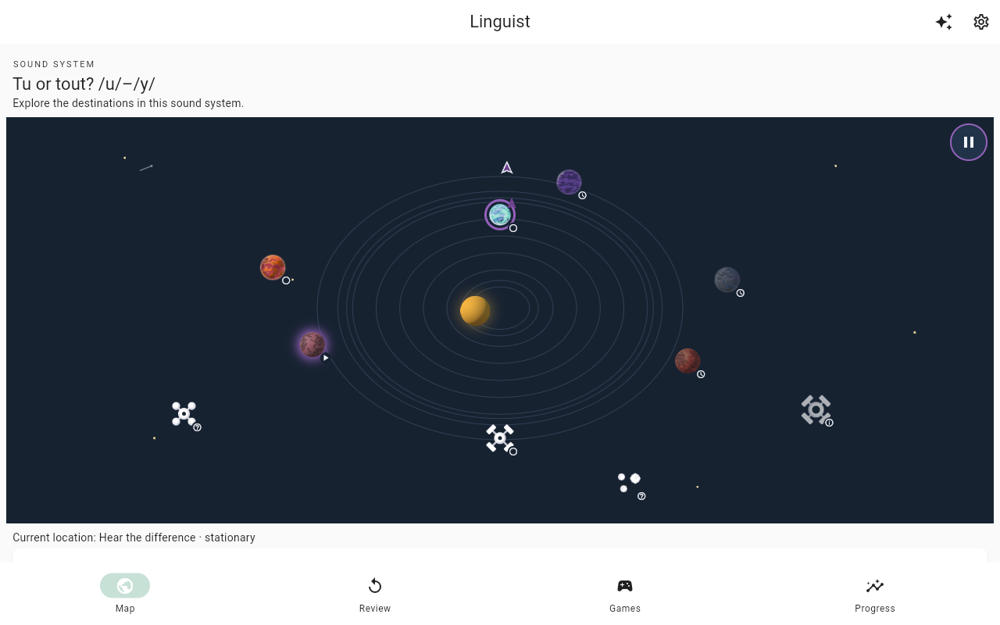
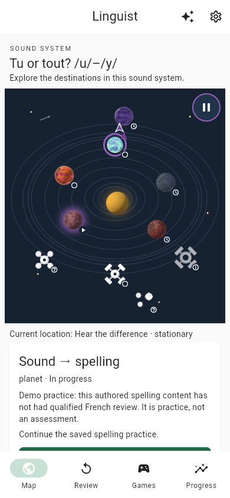
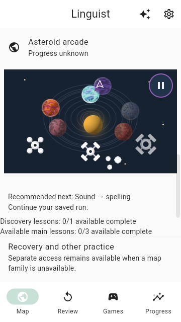

# Kenney solar-body artwork: delivered

The [hosted demo](http://mustafar.tail2c4d0.ts.net:8088/) now uses the user-selected
Kenney artwork: five distinct textured planets, a moon, three stations, a glowing
sun and a three-rock asteroid cluster. Status badges are secondary. The approved
bounded refresh changes no learning content, storage, routes, authored coordinates,
orbits, recommendation order or progress rules. Existing motion is unchanged; no
animation or dependency was added.

## Publication and review

- Implementation: [PR #128](https://github.com/klottick/phoneme-app/pull/128).
- Reviewed base: `ddd1a11726e28659ff43fea0a8a9ed9d68cd78ef`.
- Reviewed technical head: `0f2773d6e2577616e7801fe68e3fae73164b4ec8`.
- Published squash commit: `fde4c0dd956eb4ee487baa0f066a7ac04e174af2`, titled
  **`feat(course-map): add Kenney solar-body artwork`**. Its tree exactly matches
  the verified head. The initial pushed worker commit was retained, not rewritten;
  the follow-up fix and final delivery use Conventional Commit messages.
- Controller reviewed the actual diffs and obtained independent read-only review.
  Review caught an image-test false positive; the corrected test loads and decodes
  every image instance in both layouts, pins exact mappings, and has a failing
  missing-path control. The controller's phone screenshots exposed overlapping
  asteroids; the three-rock fix has count/spacing coverage and new screenshots.
  Role-appropriate unknown-ID/error fallbacks were also preserved.
- Independent re-review found no remaining blocking findings. Exact GitHub head,
  current base, mergeability and feedback were checked before merge. No check runs,
  commit statuses or formal GitHub reviews were reported; **missing CI was not a
  passing CI result**. No protection bypass, admin override, force-push, direct push
  to `main`, unreviewed local integration or destructive cleanup was used.

## Verification evidence and limits

Pinned SDK: `/home/klottick/develop/flutter-3.47.7-sqlite/bin/{flutter,dart}`.
Controller verification ran on the final technical head with unchanged-tree checks:

| Gate | Result |
| --- | --- |
| Ordinary unit/widget set | **1,747 passed / 141 files**, exit 0, 291.754 seconds. Sorted top-level `test/unit` and `test/widget` targets, `flutter test --no-pub --concurrency=1 --reporter expanded`. Excluded exactly `course_learning_retention_test.dart` and `learning_sql_retention_test.dart`, as in prior delivery; exclusions are not passes. |
| Analysis / format | `flutter analyze --no-pub`: no issues. Scoped `dart format --output=none --set-exit-if-changed`: two files, zero changes. |
| Build | `flutter build web --release --no-pub`: passed. Existing `flutter_tts` Wasm dry-run findings remain; not a Wasm build or qualification. |
| Artwork / licenses | All 12 runtime PNGs and build copies match the documented original archive mappings. PNG chunk CRC/inflate audit passed; original license files byte-identical. Scoped diff whitespace passed except intentionally preserved upstream license whitespace. |
| Browser visuals | Controller viewed production screenshots at desktop 1280×800, phone 390×844 and compact fallback 360×640. Three rocks, secondary status cues and current ring/ship versus selected glow are distinguishable. Existing 48-pixel target, non-overlap, keyboard, semantics, readiness-fade and motion regressions remain covered. |
| Local production reload | Actual full-page home/dedicated reload, Continue and viewport inspection preserve all 13 normalized tables: one answer, two receipts, physical schema v2. Controlled fake audio only. |

The ordinary output retains 33 existing Drift debug warnings, not suppressed or
treated as concurrency proof. Schema/migration qualification was not repeated for
this visual-only change. Native-device and assistive-technology testing remain
separate from widget tests and emulated desktop-browser viewports.

## Hosted update and pre-existing progress

The primary checkout was clean apart from preserved unrelated untracked browser
artifacts and fast-forwarded to the reviewed merged source. The existing updater,
`python3 scripts/local_demo.py update --flutter
/home/klottick/develop/flutter-3.47.7-sqlite/bin/flutter`, retained locked dependency
resolution and atomically published release **`fde4c0dd956e-d0cd6706c919`** at
**2026-10-24T04:58:02.754041+00:00**. No service configuration or user data was changed;
prior releases, other branches/worktrees, Sound Match work and evidence remain.

Hosted `demo-build.json` identifies the exact source. The hosted JavaScript,
SQLite worker/WASM, metadata and all 12 PNGs match the published release bytes.
An owned browser profile populated on the **old** release was reopened after this
update. Full home refresh, Continue spelling and viewport inspection restored the
same saved feedback without modifying any of the 13 normalized table snapshots.
One answer and two receipts remained; reopening caused no playback/TTS requests.
This is synthetic progress using controlled fake audio, **not real playback or
linguistic qualification**, and does not imply every browser/storage backend was tested.

Hosted screenshots from that preserved profile:

## Provenance, deferred work and open gates

The minimal [Planets / Simple Space subset and original CC0 licenses](../../../frontend/assets/images/course_map/README.md)
are versioned with archive URLs, SHA-256 values and exact file mappings. No runtime
network image dependency was added. Artwork is copied without pixel modifications;
the sun uses a documented runtime tint. CC0 artwork provenance closes no unrelated
French-recording rights/content gate.

Nonblocking deferred optimization: source-resolution image decoding is oversized
for 38–44-pixel markers (about 41.8 MiB intrinsic RGBA for the subset); no measured
performance failure was established. Runtime PNG payload is 1,917,241 bytes.
Qualified French/content/recording review, real playback, assistive technology,
privacy, assessment suitability, physical mobile devices and broader release
qualifications remain open as recorded in the [spelling delivery status](2026-10-24-uy-demo-spelling.md).
No database reset, downgrade or old-binary rollback is authorized.

Exact manifests, command/exit logs, original failures and negative controls,
independent reviews, asset/hash audits, normalized snapshots, preserved profiles
and publication records remain local in
`.superpowers/sdd/2026-10-24-kenney-map-art/`. Raw agent/browser state stays ignored;
only this concise durable record and selected screenshots are committed.
