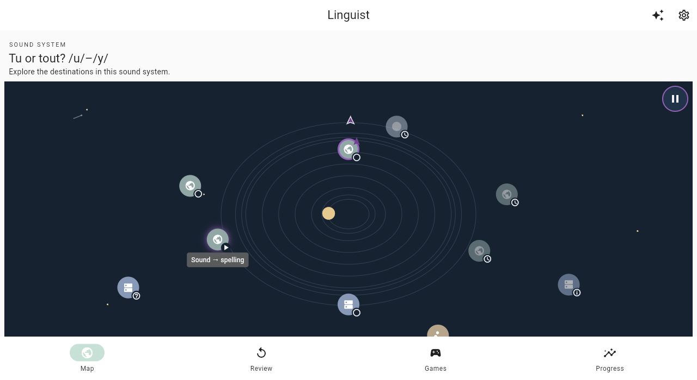
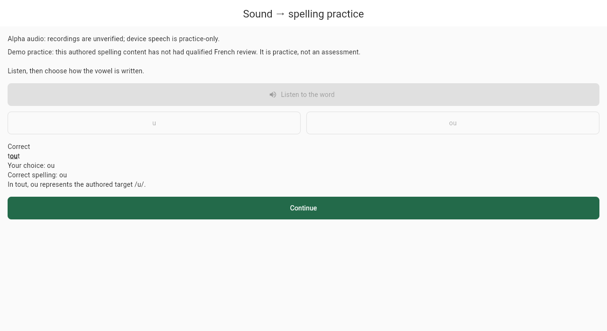

# /u/–/y/ spelling demo: delivered, qualifications open

**Sound → spelling is live as the third recommended main lesson**, after
discovery and comparison, at [the hosted demo](http://mustafar.tail2c4d0.ts.net:8088/).
The six implementation tasks and a whole-feature review fix were delivered through
reviewed GitHub PRs, not unpublished local merges. Context and checkpoint remain
planned; this does not promote global spelling coverage or assessment readiness.

Authority: [approved specification](../specs/2026-10-23-uy-demo-spelling-design.md)
(PR #118) and [separately approved plan](../plans/2026-10-23-uy-demo-spelling-implementation.md)
(PR #119). This record changes neither requirement nor qualification policy.

## Delivered behavior

- Ten audio-first `u`/`ou` choices use the existing pending French word recordings.
  The word, highlighted spelling, correctness and explanation appear only after
  durable save confirmation or strict restoration of that saved answer.
- Immutable first-attempt outcomes remain separate from feedback-assisted latest
  outcomes. Only an acknowledged qualifying practice Finish at the saved80%
  policy records completion; review-only generations and inspection earn none.
- Spelling owns its checkpoint/progress through the existing shared SQLite
  database/coordinator. Physical schema v2 migrates strict, genuine v1 data without
  rewriting old-family payloads. Old family-profile versions stay1.
- Map body order/geometry, other destinations and appearance/recovery behavior are
  preserved. Recommendation order alone becomes discovery, comparison, spelling.
- Whole-feature review caught two UI gaps after the task reviews: terminal
  review-only navigation and an initial load interrupted by background/resume.
  Both received behavior-first regressions, one combined fix PR and independent
  scoped re-review before publication.

## Published implementation and review

Each code PR had independent read-only specification/quality review plus controller
diff and exact-head/base verification. Formal GitHub reviews/check runs were absent;
**missing CI was not counted as a passing CI result**. No protection bypass, admin
merge, force-push, direct push to `main`, or destructive cleanup was used.

| Scope | PR | Reviewed head | Published merge |
|---|---|---|---|
| Catalogue | [#120](https://github.com/klottick/phoneme-app/pull/120) | `1065793fd67797ef90b30941e09b6feef563debc` | `75cde62ffff0cf57ba711e7de414844f5ca7d625` |
| Physical v2 / migration | [#121](https://github.com/klottick/phoneme-app/pull/121) | `e0da919a1985eb7c2c9542769e631d6ce379e2d5` | `5f15c7ddff06321659df810b523c8984b36f7b03` |
| Domain / codecs | [#122](https://github.com/klottick/phoneme-app/pull/122) | `745da1c96aaedda9a5c5143934c801e0b81c9b2c` | `2feedf8e74f0c34996304309c8d9cde063b4f7e2` |
| SQL / providers | [#123](https://github.com/klottick/phoneme-app/pull/123) | `d1d38c1b31f0634cc029139ee885eb28b918d019` | `503480bef873ae5992e76ffef203359f7ed018e9` |
| Route / screen / grants | [#124](https://github.com/klottick/phoneme-app/pull/124) | `e5561345fdcf2bf266ef55ab2a623e9aceb42ddf` | `d66a0f8579a3722668b8637b5210f00458f3bb5f` |
| Map / browser workflow | [#125](https://github.com/klottick/phoneme-app/pull/125) | `3ac593e55546ce1153fd06fc206d24f65065a320` | `7e930eef3ba82dcca021c05987a71d2e743c113d` |
| Whole-feature UI fixes | [#126](https://github.com/klottick/phoneme-app/pull/126) | `c809a89501486f1f2b561d36f41f0985d54e9b7f` | `ca4a0e0723f55570c73bad93c46cf13ed3bbc033` |

Final technical source is `ca4a0e0723f55570c73bad93c46cf13ed3bbc033`. Published
merge trees were checked against their reviewed heads. Documentation-only delivery
records do not require replacing the runtime artifact with a different code build.

## Verification: separate gates, not substitutes

Pinned SDK: `/home/klottick/develop/flutter-3.47.7-sqlite/bin/{flutter,dart}`.
Final gates ran on the final published technical source, after reviewed merges:

| Gate | Result and boundary |
|---|---|
| Ordinary unit/widget set | **1,745 passed /140 files**, exit0,297.44s, empty stderr. Sorted top-level files only; excluded exactly `course_learning_retention_test.dart` and `learning_sql_retention_test.dart`. Exclusions are not passes. |
| Native physical schema/migration | **42 passed**, including strict v0/v1/v2 rejection, data preservation, injected failures and actual overlapping native opens. |
| Real persistent-web migration | **Six cases passed**, selected `sharedIndexedDb`; precommit rollback, postcommit v2 retention/unsafe-channel close/fresh retry, and concurrent command retry with one receipt. |
| Production-router/SQL spelling workflow | Passed: truev1→v2, all13 old-family relation snapshots/canonical strings/outbox order preserved, one answer/two receipts/one controlled recording request, saved feedback after same-page handle reopen without duplicate work. **Not a full-page reload.** |
| Analysis / build | Analyzer no issues; default release JavaScript build passed. Existing `flutter_tts` Wasm dry-run warnings remain; **not a Wasm build or qualification**. |
| Formatting / whitespace | New files and scoped changes checked; five legacy files already fail whole-file formatting. Baseline layout was retained rather than globally reformatted; provider/router wrapping/indentation exceptions are explicit. `git diff --check` passed. |
| Technical audio metadata | `python3 scripts/verify_french_audio.py` passed for24 pending candidates. **Not linguistic, rights or playback review.** |

The exact ordinary command was the saved sorted manifest passed to
`flutter test --no-pub --concurrency=1 --reporter expanded`, bounded at600seconds.
Native migration used the separate schema test target. Both browser targets used
bounded `flutter drive --no-pub --driver=test_driver/integration_test.dart ...
-d web-server`, Chrome/ChromeDriver **156.0.8078.4**, owned ports and fresh profiles.
Worker and WASM assets returned200 with `application/wasm` for SQLite.

The final ordinary output retains33 Drift debug warnings:29 prior legacy warnings,
one intentional schema-concurrency case and three spelling SQL completion/failure
cases. They were neither suppressed nor treated as concurrency-safety evidence.
Early failed ordinary runs were preserved and fixed, not waived by smaller suites.

## Atomic demo publication and actual-URL reload

The primary checkout was clean and fast-forwarded from `1e7ee05` to the reviewed
technical source. The existing updater, `python3 scripts/local_demo.py update
--flutter /home/klottick/develop/flutter-3.47.7-sqlite/bin/flutter`, built and
atomically published release **`ca4a0e0723f5-0eca8cd8bf0b`** at
**2026-10-24T03:56:48.363583+00:00**. Its existing locked dependency resolution
was retained; lockfiles/source stayed unchanged. No package upgrade or service
reconfiguration occurred. Prior releases, `origin`, service overrides, user progress,
other branches/worktrees, Sound Match work and process/browser evidence were preserved.

HTTP build metadata reports the exact source; hosted JavaScript/worker/WASM hashes
match the published release. Actual hosted home and dedicated-lesson reload checks
passed using a fresh owned profile and **controlled fake recording audio**, with no
real playback or TTS. This is separate from WebDriver's in-page reopen test:

1. Normal French course entry → map → Start spelling → explicit Start practice →
   one simulated recording → `ou` → acknowledged saved feedback.
2. The actual map-launch `href` remained
   `http://mustafar.tail2c4d0.ts.net:8088/#/home`; it was recorded, not assumed to
   change with imperative routing. Explicit full refresh of that URL restored the
   in-progress destination; Continue spelling restored the same feedback.
3. Full refresh of
   `http://mustafar.tail2c4d0.ts.net:8088/#/course-spelling/en-fr-u-y-spelling`
   also restored feedback. Distinct `performance.timeOrigin` values confirmed new
   documents rather than merely hash navigation.
4. Read-only IndexedDB VFS exports compared **all13 normalized tables** before/after
   home refresh, Continue and dedicated refresh. Rows/checkpoint/canonical receipts
   stayed identical: physicalv2, **one answer, two receipts, no completion**. Later
   documents issued zero playback/TTS requests. No profile data was cleared.

The same production-build reload check also passed on an owned loopback preview.
An initial harness attempt used hash navigation without forcing refresh; its
failure was preserved, the harness was corrected, and neither that attempt nor an
in-page reopen was mislabeled as full-page proof.

Hosted-run screenshots (1280×700; synthetic test progress, not real-audio evidence):

## Recorded decisions and evidence limits

- The user-selected sequential Luna6 implementation workflow was retained except
  Task2's explicit controller takeover; worker changes/evidence were backed up,
  not discarded. Code delivery still required independent review and GitHub merge.
- Shared portable v1 fixtures use an integration-support body and test re-export;
  the frozen oracle is production-owned, independent of v2 generated models. These
  bounded path adjustments avoid competing oracles and web import failures.
- A two-output bounded codegen run restored an accidentally deleted existing
  smoke-test output byte-for-byte; no generated artifact or dependency drift shipped.
- Browser test expectations were corrected for GET-versus-HEAD serving and remote
  exception serialization; the actual unawaited exclusive-release cleanup race
  was fixed in the validated opener, not dismissed as a test issue.
- Test temporary storage moved off quota-exhausted `/tmp` using subprocess-local
  paths. No global configuration, user data, profiles or evidence was deleted.
- New map progress reads required narrowly authorized spelling-provider overrides
  in three comparison fixtures and readiness-aware direct routing in two spelling
  fixtures. Original zero-acquisition/exact-one-load assertions remain intact.
- The unrelated global error-page change was removed. Whole-feature review's
  review-only and initial-load defects were fixed together with real regressions.
  An explicit restart from a review URL may require the existing Continue practice
  step; no entry/query change starts a generation or grants credit.
- Legacy formatting exceptions are cosmetic and disclosed, not blanket formatter
  passes. Initial Task5 route/screen RED exact-command/exit sidecars and Task6 map
  RED command sidecar were not retained; assertion output remains. Reconstructed
  commands are not exact historical proof. Later fix/browser commands/exits are saved.

**Deferred minors:** an additional typed-valid old-profile migration-and-read test
beyond the approved opaque raw-cell preservation fixture; retained warning noise.
Existing codec/SQL/provider suites pass, but opaque fixture JSON is not claimed as
semantic rehydration proof. Task3's missing below80/pre-debrief Finish tests were
subsequently covered by actual repository rejection tests.

Raw manifests, commands/exits, review reports, before/after SQLite exports, source/
artifact hashes, browser profiles and publication records remain in the local
`.superpowers/sdd/2026-10-23-uy-demo-spelling-implementation/` workspace and owned
user-cache profiles. In particular: `release-main-*`, `final-review.md`,
`final-fix-review.md`, `release-atomic-update.json`, `release-hosted-verification.json`,
and `reload-hosted-production-01/`. No automatic evidence/worktree cleanup occurred.

## Gates that remain open

This is clearly labeled best-effort **practice**, not assessment, mastery or a
qualified French lesson. Qualified French/content/recording review, rights/licensing,
real browser/device playback, assistive-technology accessibility, privacy, assessment
suitability, iOS/Android and broader release qualification remain open. Pending
recordings were not promoted to reviewed/assessment assets. The tested persistent
backend/profile is not a universal origin, quota, auth, browser or platform guarantee.

**Older binaries after physicalv2 are unsupported.** Do not automatically roll the
binary back, downgrade/reset SQLite or wipe progress. Recovery must preserve v2
data through forward repair or separately reviewed recovery. Prior artifacts are
retained as evidence, not authorization for an old-binary/data rollback.
