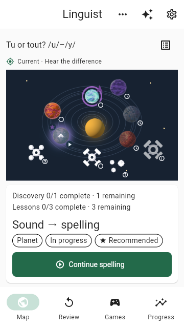
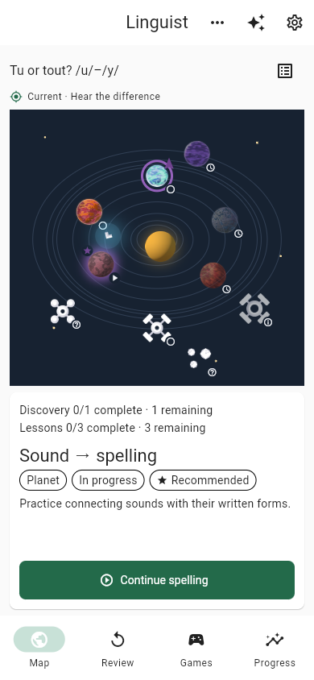
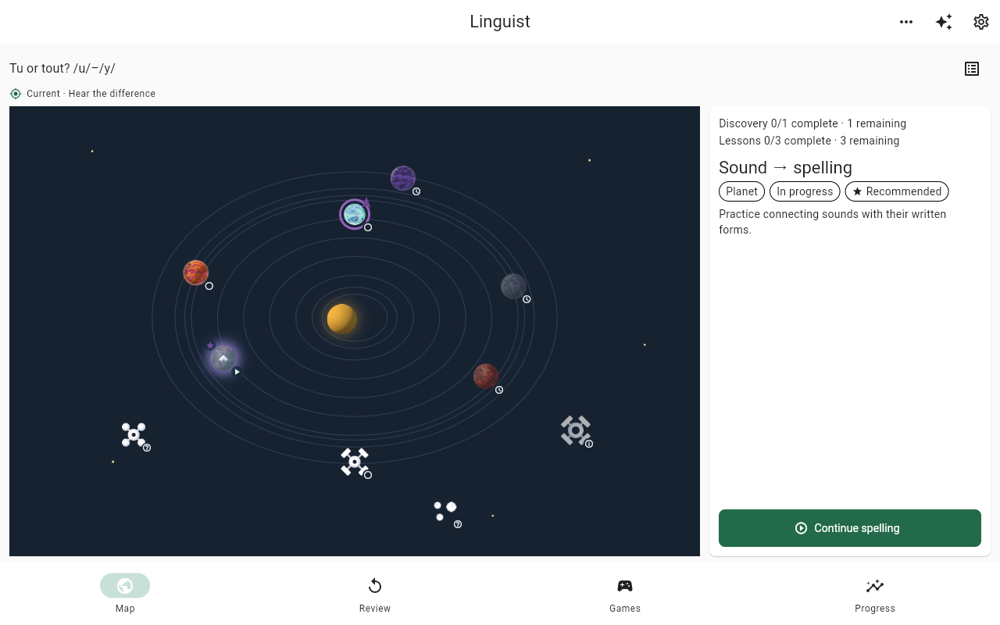
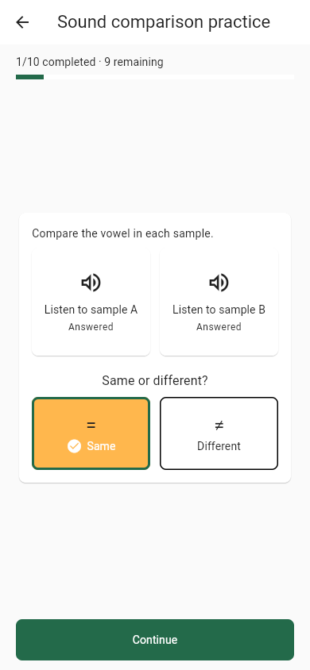

# Phone-first animated UI refresh: delivered

The user-approved phone-first animated direction is published at the
[hosted demo](http://mustafar.tail2c4d0.ts.net:8088/). The map and lesson
presentation target 360×640 and 390×844 first, while supporting 1280×800
desktop. The integrated runtime source is
`818c335765198f0da798e541498d3c1908cf5adf`; the final reviewed technical head
`10cde616078734befc50014ac07691e6ecd215bf` has the same tree.

## Publication and review

The runtime work was delivered through four reviewed GitHub PRs, each merged
through its PR with the merged tree verified against the reviewed head:

| Scope | PR | Reviewed base | Reviewed head | Merge commit |
| --- | --- | --- | --- | --- |
| Map-first presentation | [#130](https://github.com/klottick/phoneme-app/pull/130) | `8d8347c4c90f31e6f3280e0ec5f5ccd3dda705f3` | `efd136043a0d522a27a82723939b972586d0822f` | `363ac6d4404362ed351ef5fd73151c97c3e46c05` |
| Lesson presentation and progress | [#131](https://github.com/klottick/phoneme-app/pull/131) | `363ac6d4404362ed351ef5fd73151c97c3e46c05` | `c03ab1616b452058d7fea6a4e9223521ca6142f3` | `92213bf520c1a5c08cebd2557f822ad4e1ea5659` |
| Preview and lesson motion | [#132](https://github.com/klottick/phoneme-app/pull/132) | `92213bf520c1a5c08cebd2557f822ad4e1ea5659` | `51963971755be3a332261dfa34e764911d13b29b` | `f067717938830c3bf62679392a75c543e42a9841` |
| Actual comparison-question identity | [#133](https://github.com/klottick/phoneme-app/pull/133) | `f067717938830c3bf62679392a75c543e42a9841` | `10cde616078734befc50014ac07691e6ecd215bf` | `818c335765198f0da798e541498d3c1908cf5adf` |

Independent review found and corrected integration issues involving owner and
picker recovery, hit testing, below-threshold uncredited spelling completion,
stale acknowledged-owner progress, sample-status semantics, real page/sheet
coverage, inspector keyboard focus, curve-listener ownership, and comparison
question identity. A suspected missing-counter paint was disproved by a PNG
pixel audit; no speculative source fix was made.

## Delivered behavior

- The map fits without scrolling at the supported phone sizes, keeps its
  primary action near the bottom, and opens destination/tools sheets for
  secondary actions. It has no old map footer or pause control. The actual
  location marker remains distinct from the finite, interruptible preview-ship
  travel; reduced motion takes an immediate stable path.
- Finite practice shows acknowledged done/total and remaining counts, including
  wrong answers, with separate review queues. Endless practice is not assigned
  invented totals. Comparison uses spacious A/B choices, symbols with labels,
  visible heard/playing/answered/selected states, and a visibly selected,
  disabled answer. Hearing prerequisites and learning/persistence policies are
  preserved.
- Screen, inspector, problem and feedback transitions are covered; outgoing
  content is inert to pointer input, semantics and focus. App lifecycle and
  actual covering page/popup routes suspend preview travel through dismissal.
  PR #133 fixes comparison transitions using the actual question identity,
  stable across playback, saves, acknowledgment and feedback.
- Real unavailable/error/recovery text and legal credits remain. Routine
  repeated alpha/demo qualifiers were removed without changing qualification
  gates.

## Hosted publication and evidence

The existing atomic updater published release **`818c33576519-deb8616840d1`**
from source `818c335765198f0da798e541498d3c1908cf5adf`, built
**2026-10-29T04:29:55.869913+00:00**. The existing service configuration was
unchanged, locked dependency resolution was retained, and the previous release
was kept. Hosted `demo-build.json`, index, JavaScript, SQLite worker/WASM and
all 13 runtime PNG files match the release bytes. The [CC0 ship-art source and
license mapping](../../../frontend/assets/images/course_map/README.md) remains
documented with its licenses.

The preserved profile was seeded on the previous runtime
`fde4c0dd956eb4ee487baa0f066a7ac04e174af2`. Full home and dedicated-route
reloads plus Continue restored the same saved feedback; all 13 normalized
tables stayed unchanged (one answer, two receipts, physical schema v2), with
zero reopening audio/TTS requests. This is synthetic progress with controlled
fake audio, not real-playback or linguistic qualification. In a separate fresh
hosted three-family probe, all three answers were acknowledged (six receipts),
each family showed 1/10 completed and nine remaining, and all 13 tables stayed
unchanged after a full dedicated-route reload.

Strict hosted map/wheel checks cover 360×640, 390×844 and 1280×800. Normal and
reduced-motion recordings were reviewed alongside widget position, finite
travel and lifecycle/suspension evidence; global frame-hash differences alone
are not proof of ship displacement. The reduced-motion emulation had two
different global frames because of other UI changes, not because the ship
moved.

## Verification and limits

On the final technical head, the controller's ordinary gate passed **1,770
tests across 144 files** in 289.934 seconds, using the sorted top-level unit
and widget manifest with
`flutter test --no-pub --concurrency=1 --reporter expanded`. It excluded exactly
`course_learning_retention_test.dart` and
`learning_sql_retention_test.dart`; these deferred tests are not passes. The
pinned Flutter/Dart tools are
`/home/klottick/develop/flutter-3.47.7-sqlite/bin/{flutter,dart}`. Controller
analysis, scoped formatting, release JavaScript build and diff check passed.
Existing `flutter_tts` Wasm dry-run findings are not Wasm qualification. An
earlier worker's 41-test log was from `ede81e5`, not the final head, and was not
used as final-head evidence.

No GitHub CI check runs or formal GitHub reviews were available; missing CI is
not a passing result. Independent read-only reviews and exact-head controller
commands are the evidence above.

Nonblocking deferred navigation issue **`phon-94d`** remains open: removing or
replacing an intermediate predecessor while a covering route is waiting to
pop can leave phantom coverage. The current flat Navigator does not expose that
path. Reconsider before introducing a topology that does; if exposed, the
failure could leave preview travel stuck. It was not fixed or silently dropped
by this refresh.

Native/mobile-device testing, real playback, linguistic/content/recording
rights review, assistive-technology device testing, privacy, assessment and
broader release gates remain open. See the
[French reference-audio policy](../../french-reference-audio.md); synthetic
fake-audio checks do not qualify recordings. No parked Sound Match work was
reactivated.

This status record and its selected captures are documentation-only. Their
commit does not rebuild, redeploy or alter the hosted runtime. Historical
records, raw evidence, user branches/worktrees and existing browser artifacts
remain preserved.
